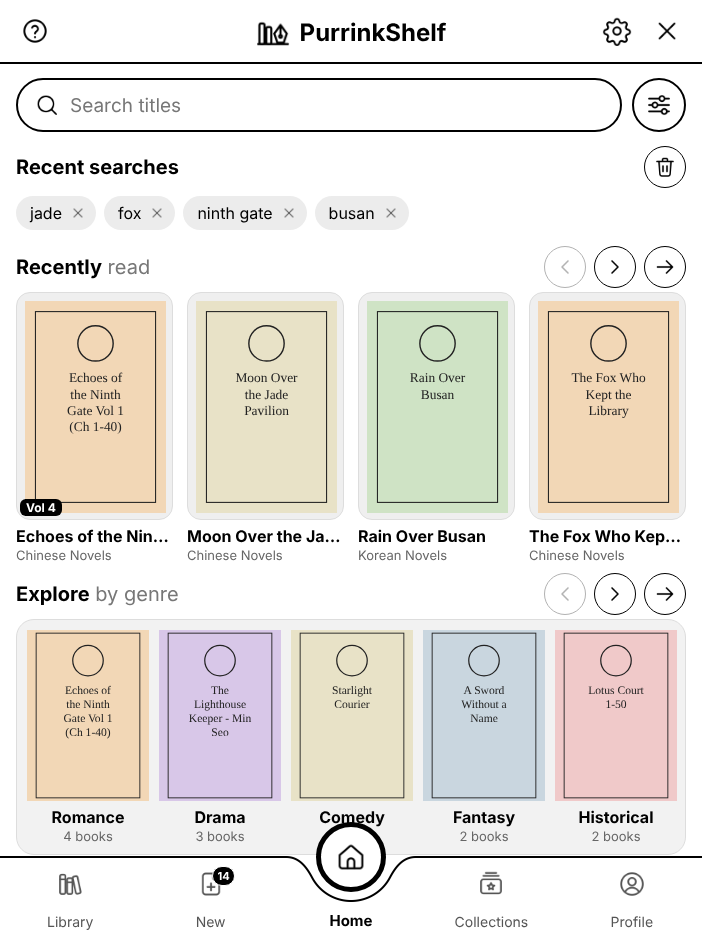
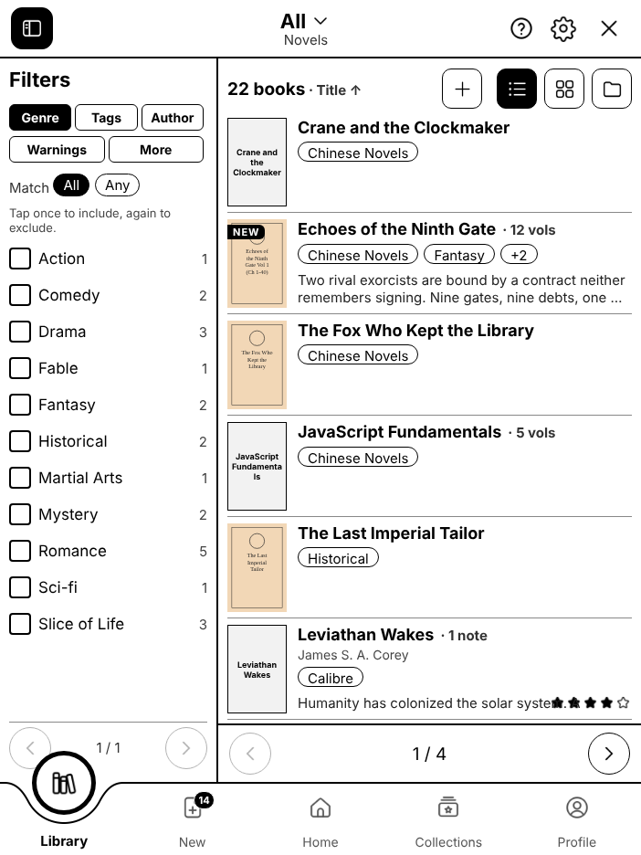
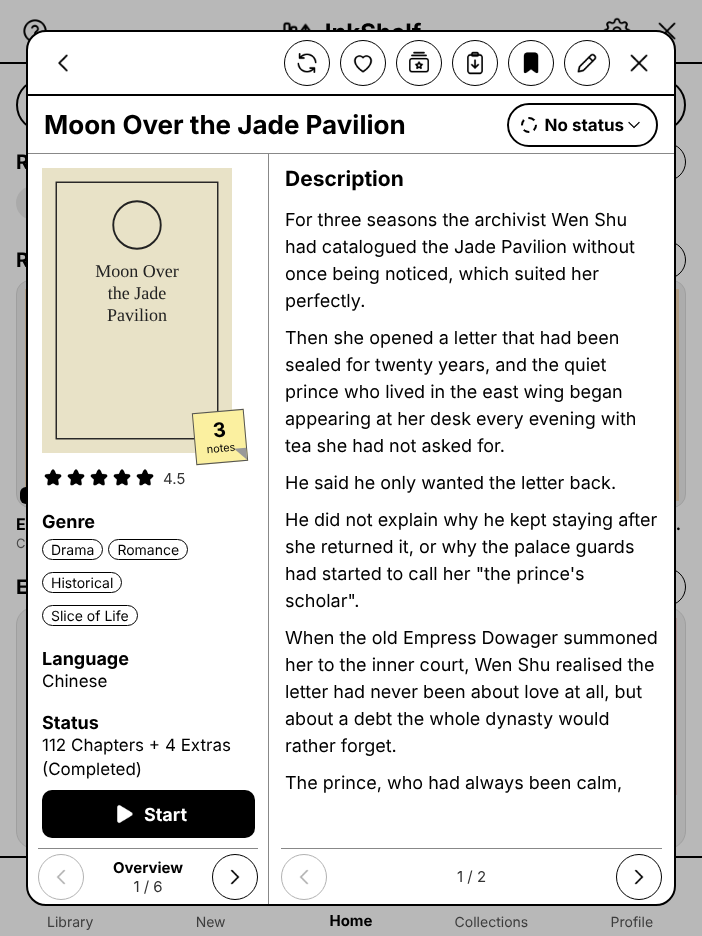
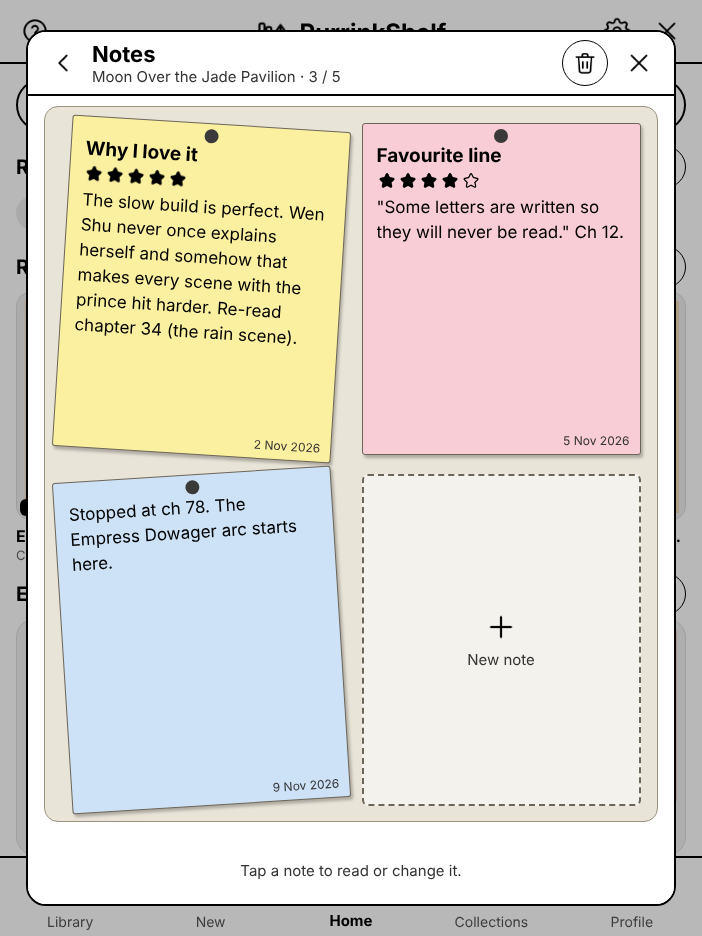
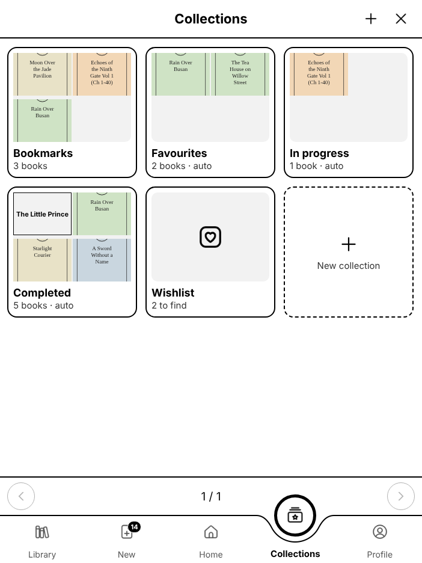
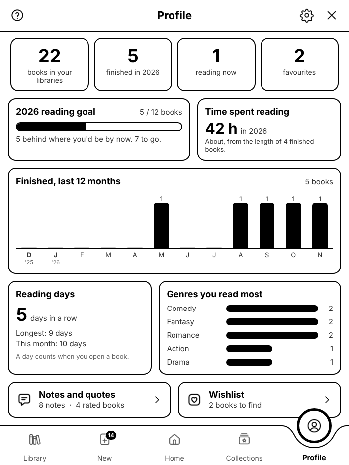

# PurrinkShelf

*Formerly InkShelf.*

A library for the books on your Supernote, in the spirit of NovelUpdates and Mihon. Point it at the folders where your EPUBs live and you get covers, genres, tags, reading status, notes and ratings, collections and stats. Everything stays on your device. You can also fill in many books at once on a computer.

  
  
  

  
  
  

*The screenshots use made-up demo books.* ▶ **[Watch the 6-minute walkthrough](docs/InkShelf-walkthrough.mp4)** of every feature.

## What it does

**Your library**
- Pick any folders on the Supernote or SD card as libraries. Subfolders become categories.
- Volumes named `Vol 1`, `Part 2`, `Chapter 3`… join into one book. You can also combine or split books by hand.
- Browse as a list, covers or folders. Filter by genre, tag, author, content warnings and more (include, exclude, match all or any). Sort by title, last read, date added, author or your rating.
- Turn pages with arrows (no scrolling needed), or switch to scrolling in Settings.
- PurrinkShelf notices new, renamed and missing files, keeps the details of missing books, and reconnects them when they come back.

**Each book**
- Its own page with the cover, description, volumes and a **Start / Continue** button that reopens the volume you were on.
- Edit the title, author, categories, genres, tags, content warnings, series, language, status, cover, where you got it, and who you lent it to.
- Fills empty details by itself from inside the EPUB, or from Calibre's `metadata.opf` and `cover.jpg` next to the book. It never overwrites what you typed.
- Reading status (plan to read, reading, completed…), with the date of every change.
- Up to five sticky notes per book, each with an optional 1–5 star rating. The book's rating is their average.
- Flags the same file twice in one folder, and sends you to the file manager to decide which to keep.

**Around it**
- **Collections:** bookmarks, favourites, in progress, completed, plus your own, with rules like "Genre is Romance, Tag is not Harem".
- **Wishlist:** books you want but don't have yet. They wait in the New tab, and come off the list by themselves when the file turns up.
- **Paper books:** list the books on your shelf too, in their own folder, with lending.
- **Profile:** books finished per month, an optional yearly goal, time spent reading, reading days in a row, and your top genres.
- **Notes and quotes:** every note from every book on one searchable board.
- **On a computer:** PurrinkShelf writes `Document/InkShelf/InkShelf books.xlsx`. It opens in Excel, Google Sheets or Numbers, with drop-downs for genres, tags, categories, status and collections. Fill it in, copy it back, and PurrinkShelf reads the changes.
- **Goodreads and StoryGraph:** import their export file (status, dates, ratings, reviews), or make a file they can import.
- **Activity:** every message PurrinkShelf shows is kept in Settings › Activity.
- **Appearance:** the Original look, or Cats: hand-drawn lines, cat toggles, paw prints on notes and little cats around the pages.
- **Show and hide:** turn parts of the Profile and book pages on or off. Nothing is deleted.
- **How to use:** short guides with search, inside the plugin.

## Install
1. Download the latest `PurrinkShelf.snplg` from [Releases](../../releases).
2. Copy it to the **MyStyle** folder on your Supernote (USB, Supernote Cloud or Browse & Access).
3. On the Supernote: **Settings › Apps › Plugins › Add Plugin**, then pick the file.
4. Open any book or note and tap the **PurrinkShelf** button in its toolbar.
5. The first time, add a library: the gear › **Data and storage** › the folder button › choose the folder that holds your books.

Supernote asks once for each permission (read files, write files). Choose **Always allow** so it doesn't ask again.

## Updating
Install the new file the same way (**Add Plugin**). It replaces the old version in place (InkShelf 1.0 updates to PurrinkShelf the same way, and keeps using the `Document/InkShelf` folder), and your libraries, details, notes and settings stay. You don't need to uninstall first.

PurrinkShelf also keeps a backup in `Document/InkShelf/InkShelf backup.json` after every change. If you ever remove and reinstall the plugin, it finds the backup and restores everything by itself.

## Privacy
- **No internet.** PurrinkShelf never connects to the internet. There are no accounts, ads, analytics or tracking, and nothing is uploaded anywhere.
- **Permissions:** it asks Supernote to read files (to find your books) and to write files (to save your details, notes, covers and backup).
- **Your books are never changed or deleted.** It only reads them. The only files it ever deletes are its own paper-book listings (`.paper` files), when you remove one. Duplicates are left for you to delete in the file manager.
- **Where your data lives**, all on the device:
  - a hidden `.inkshelf` folder inside each library (your details travel with your books). If the SD card can't be written to, they are kept with the plugin instead.
  - `Document/InkShelf/`: the backup, covers you chose, the spreadsheet, the Goodreads/StoryGraph file, and a small log (`InkShelf-log.txt`) of what it did. The log helps with bug reports and only leaves the device if you send it to someone.
- Imports (Calibre, the spreadsheet, Goodreads or StoryGraph files) read only the files you give it.

## Status
Built and tested on a Supernote Nomad (A6 X2). It may work on the Manta (A5 X2) too, but it hasn't been tested there. Bug reports and ideas are welcome in [Issues](../../issues).

## How it was made
PurrinkShelf was vibe-coded: I designed it, decided how everything should look and work, and tested it on my own Nomad, while the code was written with Claude (an AI by Anthropic).

## License
Free to use, but not open source. You may install it, share the official release, and change it for your own private use. You may not share changed versions, use it as the base of another plugin or app, or sell it, without asking first. See [LICENSE](LICENSE).

## Build (for the curious)
Pushing to `main` builds `PurrinkShelf.snplg` with GitHub Actions: React Native with [sn-plugin-lib](https://www.npmjs.com/package/sn-plugin-lib), plus a small native module. To build locally you need Node 20, JDK 17 and the Android SDK, then run `bash buildPlugin.sh`. `tools/preview` renders the screens in a browser with a pretend Supernote and demo books.

## Credits
Opening documents in Supernote's reader follows the approach documented by
[supernote-plugin-research](https://github.com/apclark31/supernote-plugin-research) (SuperTask) and
[supernote-dashboard](https://github.com/AgP42) by AgP42.
